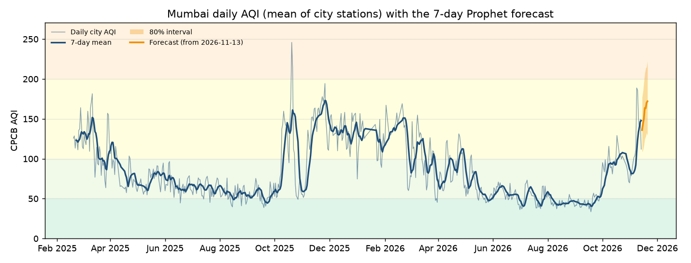
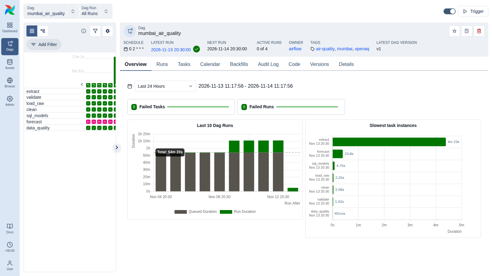
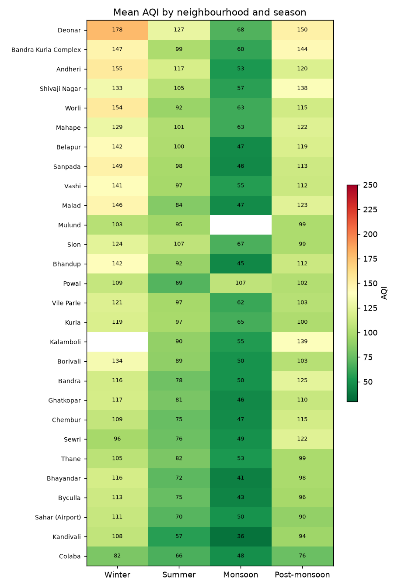
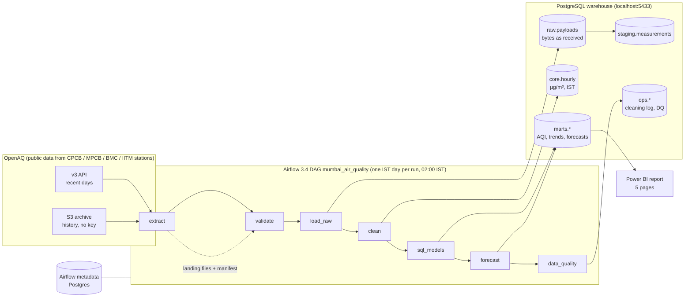

# Mumbai Air Quality Pipeline

An Airflow pipeline that pulls air-quality readings for every Mumbai monitoring station from
OpenAQ each day, cleans them and loads them into PostgreSQL. SQL models compute the official CPCB
National AQI and daily, weekly and seasonal trends, Prophet makes a 7-day AQI forecast, and a
Power BI report compares neighbourhoods and pollutants.



<!-- RESULTS_START -->
__RESULTS__
<!-- RESULTS_END -->

## Screenshots

| Airflow: one green run per day | Neighbourhoods by season (from `marts.seasonal_patterns`) |
|---|---|
|  |  |

**Power BI report:** built from [`powerbi/BUILD_GUIDE.md`](powerbi/BUILD_GUIDE.md). Screenshots go
here once the `.pbix` has been built (Power BI Desktop is a Windows GUI app, so it isn't part of the
automated build).

## Architecture



- **extract**: discovers the stations within 25 km of central Mumbai (OpenAQ API), then downloads
  the day: API for the last 6 days, S3 archive for older days (it lags ~4 days but has no rate
  limit). Files land in a folder with a manifest (URL, status, SHA-256).
- **validate**: status codes, checksums, every file parses, the readings belong to that day.
- **load_raw**: stores the exact bytes in `raw.payloads` (upsert) and parses the AQI pollutants into
  `staging.measurements` (the day is replaced, never appended).
- **clean**: units → µg/m³ (CO mg/m³), sentinels, impossible values, stuck sensors (6 h flatlines),
  isolated spikes, IST hours, old/new station IDs merged → `core.hourly`.
- **sql_models**: [`sql/models/`](sql/models) run in order in one transaction: daily pollutant
  concentrations and CPCB sub-indices, daily station AQI and dominant pollutant, city AQI, weekly
  trends, seasonal patterns, neighbourhood × pollutant comparison, dominant-pollutant shares,
  coverage, dimensions for Power BI.
- **forecast**: Prophet 7-day forecast for the city and each station with enough history, with 80%
  intervals → `marts.forecasts`, plus a rolling backtest against naive baselines.
- **data_quality**: 13 checks scoped to the run day → `ops.dq_results`. Errors fail the run (e.g.
  readings duplicated, cleaning dropped everything, the models missed the day, a city AQI that
  doesn't match its stations, no forecast); warnings flag what the source did (no data that day,
  fewer stations than last week, the day ends before 22:00).

## Quickstart

Needs Docker Desktop (or Docker Engine + Compose v2) and a free
[OpenAQ API key](https://explore.openaq.org/account). Works the same in PowerShell, macOS and Linux.

```bash
git clone https://github.com/washedhunter/mumbai-air-quality-pipeline.git
cd mumbai-air-quality-pipeline
cp .env.example .env        # then put your key after OPENAQ_API_KEY= in .env
docker compose up -d --build --wait
docker compose run --rm pipeline backfill 2024-11-01 2026-11-12
docker compose run --rm pipeline run-day 2026-11-13
```

- `backfill` creates one Airflow run per day through `airflow backfill create` and waits for all
  of them (about 80 minutes for two years with 8 runs in parallel). Use any range; days without
  data simply have fewer rows.
- `run-day` runs (or re-runs) one day, including the forecast. Use yesterday's date.
- Airflow UI: <http://localhost:8080> (local only, no login). Warehouse: `localhost:5433`, database
  `air_quality`, user/password `aq`/`aq`.
- Re-running either command is safe: every step replaces its own rows.
- `run-day` and `backfill` unpause the DAG, which turns on the daily schedule (02:00 IST, for the
  previous day): Airflow immediately starts a run for yesterday as well. Without an API key
  that run fails at `extract` (expected; it needs the API). Pause the DAG in the UI if you
  only want the sample.

**No key?** Put `EXTRACT_SOURCE=sample`, `FORECAST_MIN_DAYS_CITY=10` and
`FORECAST_MIN_DAYS_STATION=10` in `.env` and use the committed sample instead
(6 stations, 27 Oct – 9 Nov 2026): `docker compose run --rm pipeline backfill 2026-10-27 2026-11-08`,
then `docker compose run --rm pipeline run-day 2026-11-09`.

**Reports and charts** (`reports/*.md`, `docs/img/*.png`) are regenerated from the warehouse with
`uv run aq report --img-dir docs/img` (needs [uv](https://docs.astral.sh/uv/)).

**Tests:** `uv sync`, then `uv run pytest`. Set `TEST_WAREHOUSE_DSN` to a scratch Postgres database
to also run the integration tests (whole pipeline on the sample, idempotency, SQL-vs-Python AQI).

## Project structure

```
dags/mumbai_air_quality.py     the DAG (thin: each task calls a function in mumbai_aq.pipeline)
src/mumbai_aq/
  openaq.py                    API + S3 archive clients (rate limits, retries)
  extract.py  validate.py      landing folder + manifest; checks before loading
  parse.py  load.py            raw bytes -> staging rows; cleaning -> core.hourly (idempotent)
  clean.py                     units, sentinels, flatlines, spikes, IST hours
  aqi.py                       CPCB National AQI reference implementation
  models.py                    runs sql/models/*.sql
  forecast.py                  Prophet + naive baselines + rolling backtest
  dq.py                        data-quality checks
  reporting.py  plots.py       reports/*.md and docs/img/*.png from the warehouse
  cli.py                       `aq`: run-day, backfill, status, init-db, local-run, report, make-sample
sql/schema/001_init.sql        raw / staging / core / marts / ops schemas, AQI SQL functions
sql/models/                    10_daily_pollutant ... 96_backtest_summary
config/stations.csv            44 OpenAQ location IDs -> 39 stations, neighbourhood, zone
data/sample/                   14 days x 6 stations of real OpenAQ archive files (CI + key-free demo)
powerbi/                       BUILD_GUIDE.md, measures.dax, theme.json
reports/                       backtest.md, coverage.md, summary.json from the last full run
docker/airflow.Dockerfile      Airflow 3.4.0 + this package (installed within Airflow's constraints)
compose.yaml                   Airflow (LocalExecutor) + metadata Postgres + warehouse Postgres
tests/                         unit, integration (Postgres) and DAG import tests
docs/DECISIONS.md              why things are built this way
```

## Design decisions and trade-offs

The full reasoning is in [docs/DECISIONS.md](docs/DECISIONS.md). The short version:

- **OpenAQ only.** It carries the official CPCB/MPCB/BMC/IITM stations with history. The
  data.gov.in feed has no history (and no key was available); WAQI's terms forbid this kind of
  analysis.
- **API for recent days, S3 archive for history.** Same values and timestamps (checked); the API
  is real-time but limited to 60 requests/min (~300 per day), and the archive has no limit but
  lags ~4 days. A two-year backfill through the API alone would take days.
- **Raw bytes kept.** Cleaning rules can change without re-downloading anything.
- **Idempotent by construction.** Each run owns one IST day and replaces its rows; the daily SQL
  models rebuild the day before to the day after, because readings stamped 00:00 and CO/O3 8-hour
  windows cross midnight. Averages use exact `numeric` arithmetic so results don't depend on row
  order. A test loads the sample days out of order, then in order, and compares checksums of every
  table.
- **AQI implemented twice on purpose.** A readable Python version with tests at every breakpoint
  edge, and the SQL version the marts use. They share one breakpoint table, and tests check they
  agree on ~3,200 values and on every station-day.
- **OpenAQ's "ppb" label is treated as CPCB's native units.** CO values in the newer CPCB stream are
  0.2–1.2 "ppb", which only makes sense as mg/m³. NO2/SO2 show no consistent conversion factor
  against the older µg/m³ sensors at the same 13 stations. Configurable (`PPB_LABEL_MEANS`).
- **Backfill runs skip the forecast.** Fitting ~30 Prophet models for each of ~740 historical days
  adds hours and nothing useful; the regular daily run forecasts from the full history.
- **LocalExecutor, two Postgres containers.** One machine, fits Docker Desktop's memory; Airflow's
  metadata and the warehouse are separate.

## Limitations and next steps

- **Station history is uneven.** Many stations only appear in OpenAQ from February 2025 (new
  CPCB IDs); some older IDs stopped in 2022. See the coverage table in
  [reports/coverage.md](reports/coverage.md). The city AQI is a mean over whichever Mumbai stations
  reported that day (between __MIN_ST__ and __MAX_ST__ stations), so it is not a fixed panel.
- **Unit labels are a judgement call** (see above). If OpenAQ fixes its CPCB units, set
  `PPB_LABEL_MEANS=true_ppb` and re-run.
- **City AQI is our own definition** (mean of station AQIs), not an official CPCB city figure.
- **Live data are unvalidated.** CPCB's real-time data are provisional; stuck sensors and spikes
  are removed by rules, not by a person.
- **Forecast:** __FORECAST_LIMITATION__
- **Next:** add weather covariates (wind, rain) to the forecast; alerting when a DQ warning repeats;
  a read-only database role for Power BI; publish the Power BI report.

## Data and licence

Air-quality data: [OpenAQ](https://openaq.org) (attribution required), originally from the Central
Pollution Control Board (CPCB) and the Maharashtra Pollution Control Board, BMC and IITM station
networks, plus the US Consulate monitor (AirNow). The committed sample in `data/sample/` is a small
unmodified subset of OpenAQ's public archive. Code: [MIT](LICENSE).
